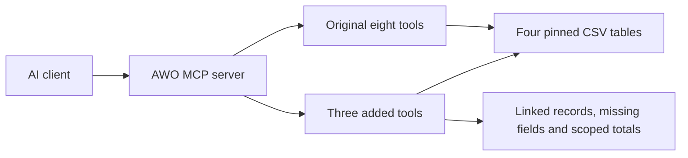

# Linked directory search for the AWO MCP server

This contribution adds three Model Context Protocol (MCP) tools for finding social-service records and inspecting their evidence. It includes portable Python source, regression tests, an integration patch, and results from a small model evaluation.

Start with the [tests](#run-the-tests) to inspect the behavior without downloading data. Use the [integration instructions](#run-with-the-reference-server) to try all 11 tools through MCP.

## What the tools add

| Tool | Use it to |
| --- | --- |
| `search_service_candidates` | Search service names, categories and audiences; follow explicit links to facilities or providers. |
| `get_entity_card` | Inspect an exact entity ID, recorded fields, missing values and linked records. |
| `search_directory` | Search facility and linked service/address text; filter by provider or nonblank telephone; get totals across all matches. |

The patch preserves the reference server's original eight tools. The first two additions form V2; all three form V3.

Search uses literal text matching. It does not determine eligibility, geographic coverage, proximity or current availability. Telephone values remain raw strings; a nonblank value is not a verified number. Field evidence identifies a source CSV row, not independently verified real-world provenance.



## Run the tests

The integration was tested with Python 3.11.14, `mcp==1.25.0` and `pandas==2.3.0`. The 24 unit tests use only the Python standard library and synthetic data.

From the hackathon repository root:

```bash
cd contributions/directory-search
python3.11 -m unittest discover -s tests -v
```

Expected result: 24 tests pass. They cover typed relationships, ambiguous IDs, raw contact values, pagination, filters and summaries over all matches.

## Run with the reference server

The patch targets [Atrash87/awo-mcp-production](https://github.com/Atrash87/awo-mcp-production/tree/d3842d2974bf86f1ea906436e996e67d9a043a8e) at revision `d3842d2974bf86f1ea906436e996e67d9a043a8e`. It requires Git and access to that public repository. The commands below run from this contribution directory.

1. Create an environment and install the pinned integration dependencies.

   ```bash
   python3.11 -m venv .venv
   .venv/bin/python -m pip install -r requirements-mcp.txt
   ```

2. Fetch the reference into a new local directory.

   ```bash
   git clone https://github.com/Atrash87/awo-mcp-production.git .reference/awo
   git -C .reference/awo checkout --detach d3842d2974bf86f1ea906436e996e67d9a043a8e
   ```

3. Check and apply the patch to that checkout.

   ```bash
   git -C .reference/awo apply --check ../../contribution-v3.patch
   git -C .reference/awo apply ../../contribution-v3.patch
   ```

   If the check fails, stop and inspect the reference revision and local changes. The patch is intended for an unmodified checkout at the revision above.

4. Run the real MCP smoke check.

   ```bash
   .venv/bin/python scripts/smoke.py --reference .reference/awo
   ```

   Expected result: a JSON summary with `"status": "passed"` and `"tools": 11`. This starts the patched server over stdio and checks searches, entity-card access, counts and pagination. It does not call a model or require an API key.

   An upstream FastMCP/Pydantic `IncompleteFieldDefinitionWarning` about the `lifespan` annotation is expected with the tested dependency resolution. The smoke check still passes. Use the final JSON summary to confirm success; other errors require investigation.

To connect an MCP client, use the absolute path to `.venv/bin/python` as its executable and the absolute path to `.reference/awo/server.py` as its argument. The server uses stdio. Hosted HTTP deployment is outside this contribution.

## Inspect the results

On eight fresh transfer/development questions per condition, observed complete-answer counts were Luna 6/8 with V2 and 7/8 with V3; GPT-6.1 scored 7/8 and 8/8.


These are provisional AI judgments from one replicate. Prompts and entities overlap known development material; this is not an independent held-out benchmark. GPT-6.1's additional complete answer is interpretation-sensitive: a stricter completeness requirement could leave V3 at 7/8. The [results and source notes](docs/RESULTS.md) explain the counts and limits.

The small CSV sample also differs from the broader federation. Its missing-contact rate should not be generalized.


## Review or integrate the code

| Path | Contents |
| --- | --- |
| `src/service_cards.py` | Raw-string CSV loading, typed links, service candidates and evidence cards |
| `src/directory_search.py` | Facility search, filters, pagination and full-match summaries |
| `src/service_tools.py` | Registration and descriptions for the three MCP tools |
| `tests/` | Synthetic regression tests |
| `contribution-v3.patch` | These modules and tests, plus registration changes in upstream `server.py` |
| `scripts/smoke.py` | Real subprocess MCP check for the patched reference |
| `docs/RESULTS.md` | Evaluation findings, chart sources and limitations |

The source files are provided for review and reuse. The patch packages the same implementation for the pinned reference. If you change the source or tests, update the patch before integration.

The four source CSVs are fetched from the reference repository; they are not bundled here. The full evaluation runner, private model traces and operator-specific setup remain outside this focused contribution. Historical model results are documented evidence, not results produced by the smoke check.
