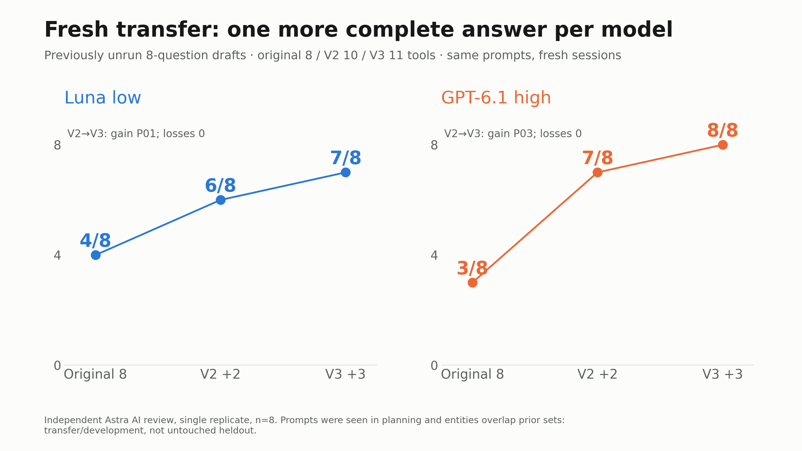
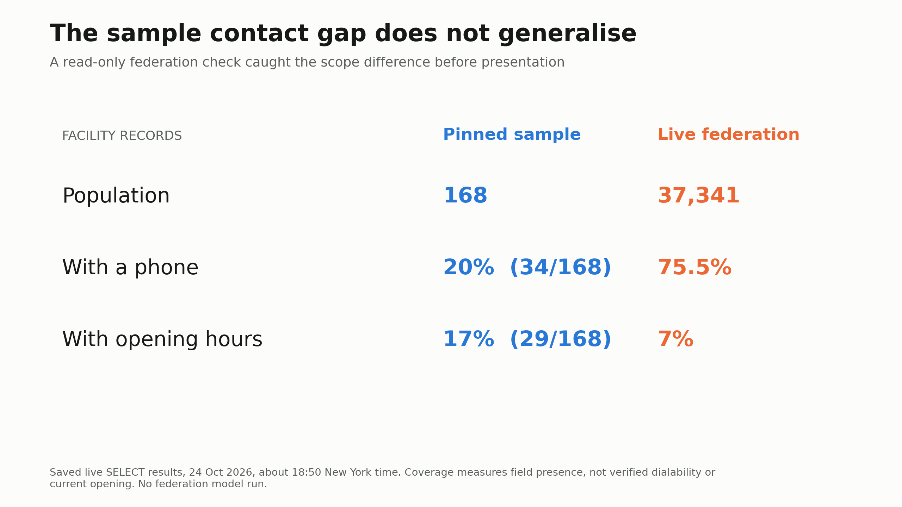

# Directory-search evidence

On eight previously unrun prompts per condition, observed complete-answer counts were 6/8 with V2 and 7/8 with V3 for Luna low, and 7/8 with V2 and 8/8 with V3 for GPT-6.1 high. These are provisional AI judgments from one run per question, with known prompt/entity overlap. They support further integration and review; they do not establish general model accuracy or federation-scale performance.

## What changed

The original reference MCP exposes eight tools. V2 retains them and adds `search_service_candidates` and `get_entity_card` (ten tools). V3 also adds `search_directory` (eleven tools): literal search across facility and linked service/address fields, a separate provider filter, nonblank-phone filtering, pagination, and summaries across the full filtered population. Stored contact strings and missing values remain explicit. Provider offices, facilities, and services retain their separate identities.

The evaluated backend is the four-CSV sample at [Atrash87/awo-mcp-production, revision d3842d2974bf86f1ea906436e996e67d9a043a8e](https://github.com/Atrash87/awo-mcp-production/tree/d3842d2974bf86f1ea906436e996e67d9a043a8e), including its [server](https://github.com/Atrash87/awo-mcp-production/blob/d3842d2974bf86f1ea906436e996e67d9a043a8e/server.py) and [data files](https://github.com/Atrash87/awo-mcp-production/tree/d3842d2974bf86f1ea906436e996e67d9a043a8e/data). It contains 168 facilities, 99 services, four providers, and 108 addresses.

## Fresh transfer comparison

| Model configuration | Original 8 tools | V2: 10 tools | V3: 11 tools | V2→V3 complete gains / losses |
| --- | ---: | ---: | ---: | --- |
| Codex Luna, low effort | 4/8 | 6/8 | 7/8 | 1 / 0 (`handoff-prof-P01`) |
| Codex GPT-6.1, high effort | 3/8 | 7/8 | 8/8 | 1 / 0 (`handoff-prof-P03`) |

All six conditions used the same eight prompts in fresh sessions: 48 attempts total. Complete means literal request fulfillment under the study rubric. Each attempt received a separate gpt-6-astra medium judgment in one of six shuffled eight-answer contexts, with model/variant labels and prior grades withheld. Preparation and reconciliation were unblinded, and tool shapes or style could reveal the condition.

[Machine-readable summary](transfer-summary.json) preserves the six condition counts and paired changes. [Paired outcomes](paired-outcomes.csv) contains all 16 V2/V3 case comparisons, without answers, private traces, or anonymous-review identity maps. Both were exported from the author's archived evaluation records on 25 October 2026. The [included chart](../figures/10-v3-transfer-complete.png) presents those counts; no new model run or chart rendering was performed for this contribution. The original execution and review records are not included, so these exports do not independently establish the underlying judgments.

[Transfer prompts](transfer-prompts.jsonl) contains the eight exact user questions and case IDs used in this comparison. These remain unapproved professional drafts used for development. The full runner and raw traces are not bundled: this public contribution supports inspecting the questions and reported outcomes, but does not reproduce the entire historical model evaluation.

The Luna gain concerns a debt-referral answer's facility/contact attribution and scope. The GPT-6.1 gain is interpretation-sensitive: the initial review accepted one explicitly qualified addiction-specific accessible women's service. Requiring an exhaustive list of specialized services could make that answer partial, leaving GPT-6.1 V3 at 7/8. Initial judgments are preserved. No complete-answer losses were observed in this single replicate.

## Sample coverage versus federation context

| Population | Facility records | With telephone | With opening hours |
| --- | ---: | ---: | ---: |
| Pinned reference sample | 168 | 34 (20.2%) | 29 (17.3%) |
| Live federation, approximately 22:50 UTC on 24 October 2026 | 37,341 | 28,193 (75.5%) | 2,622 (7.0%) |

The chart rounds sample percentages to whole numbers. [Exact counts](contact-coverage.csv) record field presence in the [pinned sample CSV](https://github.com/Atrash87/awo-mcp-production/blob/d3842d2974bf86f1ea906436e996e67d9a043a8e/data/einrichtungSchema.csv) and a dated observation of the public [directory SPARQL endpoint](https://sosuse.correlaid.org/directory/sparql). [The count queries](federation-counts.sparql) are included for reproduction. The live observation has no immutable graph revision, so rerunning it can produce different counts; the original response archive is not included. It is separate from the model experiment.

The federation's [source/configuration repository](https://github.com/foederierter-datenpool/sosuse-directory-builder) and [Civic Data Lab project page](https://civic-data.de/machen/werkstattboxen/foederierter-datenpool/) describe the wider data layer. Recorded field presence does not verify a dialable phone, current opening status, available beds, eligibility, or source ownership. The sample's missing-contact rate does not describe the whole federation. No contact number was repaired.

## Interpretation limits

- Eight prompts per condition, one replicate, AI grading, no human professional validation or inter-rater agreement. Prompt drafts were visible during planning and entities overlap earlier work; this is transfer/development evidence rather than an untouched held-out test.
- Existing recorded local checks report 106 unit tests and real subprocess MCP smoke with 8/10/11 tools. The exported integration patch separately passed temporary application, 24 included tests, and an eleven-tool server import. Those checks concern local behavior, not deployment or federation transport.
- The wider study's known-professional-question V3 comparisons used historical V2 controls. They are omitted here to keep the fresh-control result primary.
- No federation adapter or federation-scale model benchmark was tested. Literal matches and record totals do not establish geographic coverage, relevance, or completeness of real-world services.

The contribution is intended to make existing records easier to retrieve and attribute. Professional review and testing against the team's current backend remain necessary before interpreting it as validated welfare advice.
